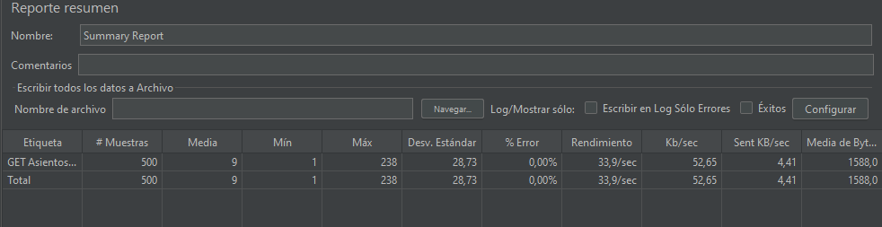

# 🎬 QA CineFlex Project

> Certificación de calidad de **CineFlex**, plataforma web de venta de boletos de cine: entorno mock (Frontend + Backend), automatización de API (Postman/Newman), automatización UI (Selenium + POM), pruebas de rendimiento (JMeter) y Continuous Testing (GitHub Actions).

## 🎥 Video de sustentación

**▶️ [Ver video de sustentación (3 min)](https://drive.google.com/file/d/1SIRLhyrdDB_5YvwkmT92yveIu52W9bAu/view?usp=drive_link)**


---

## 📁 Arquitectura del proyecto

```
qa-cineflex-project/
├── README.md
├── estrategia_pruebas.pdf          # Fase A: estrategia, stubs, regresión y comparativa
├── .github/workflows/qa-pipeline.yml  # Fase D: Newman en cada push
├── backend/                        # API REST mock (Express + Helmet + Morgan + JWT)
│   ├── server.js
│   └── package.json
├── frontend/                       # Cliente web mock con IDs listos para Selenium
│   ├── index.html
│   └── styles.css
├── api_tests/                      # Fase B: Postman
│   ├── CineFlex_API_Collection.json
│   └── CineFlex_Environment.json
├── ui_tests/                       # Fase C: Selenium WebDriver + Page Object Model
│   ├── pages/
│   │   ├── LoginPage.js
│   │   ├── CarteleraPage.js
│   │   └── ReservaPage.js
│   ├── test_suite.js               # 16 casos de prueba
│   └── package.json
└── performance/                    # Fase D: JMeter
    └── prueba_carga.jmx
```

---

## ⚙️ Requisitos previos

| Herramienta | Versión |
|---|---|
| Node.js | 20 o superior |
| Google Chrome | Última versión (Selenium Manager descarga el driver solo) |
| Postman | Desktop o Web |
| Apache JMeter | 5.6+ (requiere Java 8+) |

## 🚀 Instalación paso a paso

```bash
# 1. Clonar el repositorio
git clone https://github.com/harrihurtado/qa-cineflex-project.git
cd qa-cineflex-project

# 2. Instalar dependencias del backend
cd backend
npm install

# 3. Instalar dependencias de las pruebas UI
cd ../ui_tests
npm install

# 4. Instalar Newman (CLI de Postman)
npm install -g newman
```

## ▶️ Ejecución

### 1. Levantar Backend + Frontend
```bash
cd backend
npm run dev        # o: npm start
```
Abrir **http://localhost:3000**

| Dato de prueba | Valor |
|---|---|
| Usuario | `cliente@cineflex.com` |
| Contraseña | `Cine123*` |
| Tarjeta aprobada | `4111111111111111` |
| Tarjeta rechazada | cualquier otra (ej. `1234567890123456`) |

### 2. Pruebas de API (Fase B)
Con el backend encendido, desde la raíz:
```bash
newman run api_tests/CineFlex_API_Collection.json -e api_tests/CineFlex_Environment.json
```
También se puede importar ambos archivos en Postman y usar **Run collection**.

| Endpoint | Validaciones |
|---|---|
| `POST /api/login` | 200 OK · JSON · JWT válido · Helmet activo · **guarda el token en el environment** |
| `GET /api/cartelera` | 200 OK · JSON válido · **SLA < 300 ms** · estructura de cada película |
| `POST /api/reservas` (negativa) | 400/402 · mensaje `Pago rechazado: tarjeta inválida` · sin ticket · JSON |

### 3. Pruebas UI (Fase C)
Con el backend encendido:
```bash
cd ui_tests
npm test                 # con navegador visible
npm run test:headless    # sin ventana
```

**Patrón POM:** las clases de `pages/` solo contienen localizadores (IDs y CSS Selectors, cero XPath) y métodos de acción. Todas las aserciones viven en `test_suite.js`.

| # | Caso de prueba |
|---|---|
| CP01 | Muestra la vista de inicio de sesión |
| CP02 | Credenciales inválidas muestran error con contador |
| CP03 | Campos vacíos muestran mensaje de obligatorios |
| CP04 | **Bloqueo preventivo tras 3 intentos fallidos** |
| CP05 | **Login exitoso renderiza el título "Cartelera"** |
| CP06 | Lista al menos 3 películas |
| CP07 | Cada película tiene título y botón Comprar |
| CP08 | Botón "Cerrar sesión" visible tras login |
| CP09 | Seleccionar película abre el mapa de asientos correcto |
| CP10 | Asientos ocupados deshabilitados |
| CP11 | "Continuar al pago" solo se habilita tras elegir asiento |
| CP12 | Tarjeta falsa rechazada con mensaje de error |
| CP13 | **E2E: compra completa muestra el ticket virtual** |
| CP14 | **"Cerrar sesión" regresa al login** |
| CP15 | **Botón "Atrás" tras logout NO muestra la cartelera** |
| CP16 | Acceso directo a `/#/cartelera` sin sesión redirige al login |

> Los asientos comprados quedan ocupados en memoria. Si tras muchas ejecuciones se acaban, reinicia el backend.

### 4. Pruebas de rendimiento (Fase D)
1. Con el backend encendido, abrir `performance/prueba_carga.jmx` en JMeter.
2. Configuración: **500 usuarios virtuales**, **ramp-up 15 s**, `GET /api/asientos/1`.
3. Presionar **Start** ▶ y revisar el **Summary Report**.

Por consola (genera reporte HTML):
```bash
jmeter -n -t performance/prueba_carga.jmx -l performance/resultados.jtl -e -o performance/reporte
```

#### 📊 Evidencia – Summary Report


| Métrica | Resultado |
|---|---|
| Muestras | 500 |
| Error % | _completar_ |
| Throughput (req/s) | _completar_ |
| Tiempo promedio (ms) | _completar_ |

---

## 🔁 Continuous Testing (GitHub Actions)

El archivo `.github/workflows/qa-pipeline.yml` se ejecuta en **cada push** y en cada pull request a `main`:

1. Configura Node.js 20 en Ubuntu.
2. Instala las dependencias del backend (`npm ci`).
3. Levanta el servidor y espera a `/api/health`.
4. Ejecuta la colección Postman con **Newman**.
5. Si alguna aserción falla, el job termina en rojo.

**Bloqueo de integración:** en GitHub → *Settings → Branches → Add branch protection rule* sobre `main` → activar *Require status checks to pass before merging* → seleccionar **API Tests (Newman)**.

---

## 🔐 Seguridad y trazabilidad del backend
- **Helmet:** cabeceras HTTP seguras (`X-Content-Type-Options`, `X-Frame-Options`, `Strict-Transport-Security`, etc.). El CSP se desactiva solo porque el frontend mock usa scripts inline.
- **Morgan:** registro en consola de cada petición (método, ruta, código y tiempo).
- **JWT:** `/api/cartelera` y `/api/reservas` exigen `Authorization: Bearer <token>`.
- **Stub bancario:** `pasarelaBancariaStub()` simula la pasarela de pagos externa (ver `estrategia_pruebas.pdf`).

## 👥 Equipo
| Integrante | Rol |
|---|---|
| _Harrisson Montaña_ | _SM_ |
